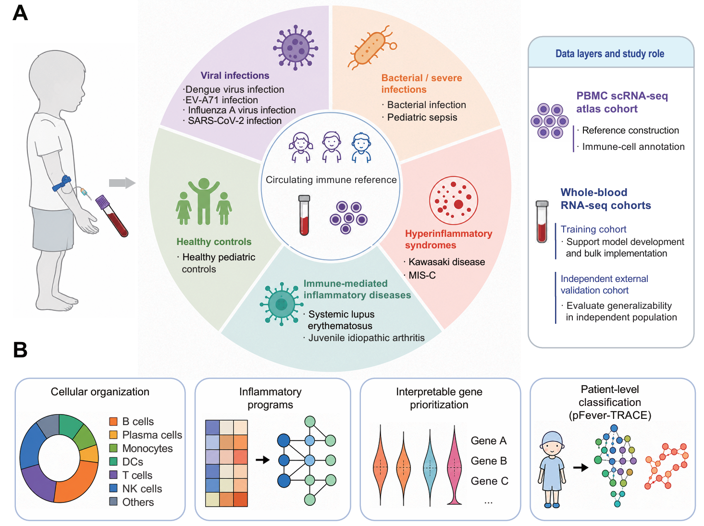

# pFever-TRACE

Code accompanying the manuscript **"A circulating immune cell atlas enables interpretable classification of pediatric febrile diseases."**

The study integrates single-cell and bulk RNA-sequencing data from 729 pediatric participants across 20 disease conditions and healthy controls. The single-cell atlas contains 617,936 peripheral blood mononuclear cells organized into 11 broad immune compartments and 52 fine cell states. The repository follows the order of the manuscript results, from atlas construction through external validation of pFever-TRACE.



> This repository contains analysis code. Controlled input data, intermediate objects, trained models, and generated figures are not committed. See [Data and local paths](#data-and-local-paths) and [Reproducibility notes](REPRODUCIBILITY.md) before running the workflow.

## Repository structure

```text
.
|-- 01_atlas_construction/
|   `-- feature_selection/
|-- 02_cellular_organization/
|-- 03_inflammation_programs/
|   |-- seacells/
|   |-- spectra/
|   `-- ulm_lmem/
|-- 04_gene_importance/
|-- 05_pfever_trace/
|   |-- single_cell/
|   `-- bulk/
|-- 06_benchmarking_and_external_validation/
|   |-- 01_internal_benchmark/
|   `-- 02_external_evaluation/
|-- data/
|-- outputs/
|-- CITATION.cff
|-- environment.yml
`-- REPRODUCIBILITY.md
```

## Analysis workflow

1. **Atlas construction and annotation** - quality control, AIFI/CellTypist annotation, gene-universe definition, scVI/scANVI integration, and integration benchmarking.
2. **Cellular organization** - observed-to-expected abundance, participant-level cell fractions, non-negative matrix factorization, and figure 2 source tables.
3. **Inflammation programs** - SEACell generation, Spectra factor learning, ULM scoring, linear mixed-effects models, and figure 3 panels.
4. **Gene importance** - compartment-specific XGBoost models, disease and study SHAP analyses, prioritized genes, and figure 4 panels.
5. **pFever-TRACE** - participant representations, compartment classifiers, majority voting, whole-blood deconvolution, and figure 5 analyses.
6. **Benchmarking and external validation** - matched comparison with the published 139-transcript signature and evaluation in independent cohorts.

Each numbered directory contains a README with the local script order, expected inputs, and outputs.

## Installation

The workflow combines Python and R. A starting Conda environment is provided:

```bash
conda env create -f environment.yml
conda activate pfever-trace
```

Several specialist R packages are not consistently available from Conda and must be installed separately: `CoVarNet`, `InstaPrism`, `sceasy`, and `SeuratDisk`. Record the resolved package versions with `sessionInfo()` or `renv::snapshot()` before producing final results.

## Data and local paths

All formerly machine-specific paths have been changed to relative paths below `data/`. Run scripts from the repository root. Place local inputs under `data/` using the layout described in [data/README.md](data/README.md). Generated files should be written under `outputs/` or the analysis-specific paths already defined by a script.

Large expression matrices, participant-level data, serialized objects, and trained models are excluded by `.gitignore`. Do not commit controlled or personally identifiable participant data.

## Web application

The research-use pFever-Immune web application is available at <https://bio-computing.hrbmu.edu.cn/pFever-Immune/>.

## Citation

Citation metadata are provided in [CITATION.cff](CITATION.cff). If you use this code, cite the accompanying manuscript after its bibliographic record is available.

## Repository status

The current release is a manuscript-associated code archive. The original single-cell worker scripts called by several stage 4 orchestration scripts are not present in the supplied folder; these dependencies are listed in [REPRODUCIBILITY.md](REPRODUCIBILITY.md). Full end-to-end execution also requires the input datasets and intermediate objects described in the manuscript supplementary tables.

## License

A software license has not yet been assigned. Until a license is added, copyright remains with the authors and reuse requires permission.

## Contact

Liang Cheng: liangcheng@hrbmu.edu.cn
